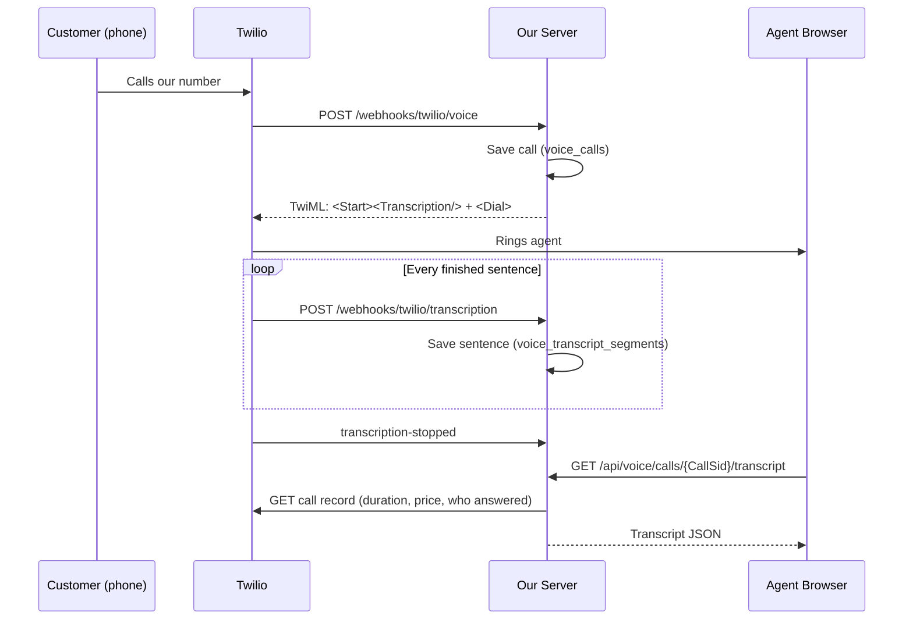

# Call transcripts

Status: Built (test-grade)
Last updated: 2026-10-19
Code: `src/voice/transcripts.ts`, `src/voice/routes.ts`, `src/voice/twilio.ts`
Research behind it: `twilio-research-transcript-tollfree.md`

## What it does

Turn on one setting, and every call is transcribed by Twilio while it happens. After the call, one JSON document holds the call details, who was on it, and the transcript.

## The flag

| Setting | Values | Default |
|---|---|---|
| `twilio_transcription` (Settings → Twilio → *Call Transcription*, or env `TWILIO_TRANSCRIPTION`) | `on` / `true` / `yes` / `1` = on; anything else = off | off |

The flag is read when a call starts. Changing it does not affect calls already in progress.

Cost: Twilio Real-Time Transcription is about **$0.027/min**, on top of call minutes.

## How it works



1. **Call starts.** The voice webhook saves a row in `voice_calls`. If the flag is on, it puts `<Start><Transcription>` in front of the `<Dial>`. `<Start>` does not block, so the call connects as usual.
2. **During the call.** Twilio posts events to `/webhooks/twilio/transcription`. Only sentences marked `Final=true` are saved; partial text is ignored.
3. **On request.** `GET /api/voice/calls/{CallSid}/transcript` builds the JSON. The first request after the call ends fetches Twilio's call record (status, times, duration, price, and on inbound calls which agent answered) and caches it in `voice_calls.details`. It is cached only once the price is known, so early requests ask Twilio again.

All Twilio webhooks are signature-checked, the same way the existing ones are.

## Output format

```json
{
  "version": 1,
  "call": {
    "sid": "CA123...",
    "direction": "inbound",
    "status": "completed",
    "startedAt": "2026-10-19T10:00:00.000Z",
    "endedAt": "2026-10-19T10:04:12.000Z",
    "durationSec": 252,
    "price": { "amount": -0.022, "currency": "USD" }
  },
  "participants": {
    "customer": {
      "number": "+14155551234",
      "name": "John Smith",
      "nameSource": "contacts",
      "location": { "city": "San Francisco", "state": "CA", "country": "US" }
    },
    "agent": { "userId": "u_42", "name": "Rina" },
    "businessNumber": "+18445550100"
  },
  "transcript": {
    "status": "completed",
    "language": "en-US",
    "engine": "google",
    "error": null,
    "segments": [
      { "seq": 1, "speaker": "customer", "text": "Hi, I want to change my order.", "startedAt": "2026-10-19T10:00:05.000Z", "confidence": 0.96 },
      { "seq": 2, "speaker": "agent", "text": "Sure, what's the order number?", "startedAt": "2026-10-19T10:00:09.000Z", "confidence": 0.98 }
    ],
    "text": "customer: Hi, I want to change my order.\nagent: Sure, what's the order number?"
  }
}
```

### Field notes

| Field | Notes |
|---|---|
| `version` | Bump this whenever a field changes meaning or is removed. Adding a field does not need a bump. |
| `call.status` | Twilio's call status: `in-progress`, `completed`, `no-answer`, `busy`, `failed`, `canceled`, or `unknown` when the Twilio API can't be reached (missing Auth Token, network error). |
| `call.endedAt`, `durationSec`, `price` | `null` until the call has ended and Twilio has the numbers. Price can lag a few minutes after the call. |
| `customer.name` / `nameSource` | `contacts`: matched `contacts.primary_phone` exactly. `twilio`: the CallerName lookup on the number, if it's turned on in Twilio. `null`: no name found. |
| `customer.location` | From Twilio's caller info. Often empty for mobile numbers. |
| `agent` | Outbound: the agent who placed the call. Inbound: the agent whose browser answered. `null` if nobody answered. |
| `transcript.status` | `disabled` (flag was off), `in-progress`, `completed`, `failed`. |
| `transcript.error` | A Twilio error code and message when `failed`, otherwise `null`. |
| `transcript.segments` | Ordered by time. `seq` starts at 1. |
| `transcript.text` | The whole transcript as one string, `speaker: text` per line. Ready for summaries. |

With the flag off, the shape stays the same: `"transcript": { "status": "disabled", ..., "segments": [], "text": "" }`.

## Who sees what

The Inbox lists calls from `GET /api/voice/calls`, using the same rule as the transcript.

| Role | Access |
|---|---|
| Operator | Every call (the Inbox narrows it to the selected organisation plus platform-number calls) |
| Admin | Their organisation's calls |
| Agent | Only calls where they are the agent |

A call belongs to the organisation whose number took it (see `connect-number.md`); calls on the platform number belong to none.

## Gotcha: which track is which speaker

Twilio labels audio relative to the call leg that ran our TwiML, not relative to the customer:

| Call | Leg running our TwiML | `inbound_track` | `outbound_track` |
|---|---|---|---|
| Inbound (phone → us) | Customer | customer | agent |
| Outbound (browser → phone) | Agent's browser | **agent** | **customer** |

`speakerFor()` in `transcripts.ts` handles this. Keep it in mind if you add new call flows, such as transfers or conferences.

## Database

- `voice_calls`: one row per call. Holds direction, numbers, location, agent, transcript status, and the cached Twilio call record in `details` (JSON).
- `voice_transcript_segments`: one row per final sentence. The key is `(transcription_sid, track, sequence_id)`, so Twilio retries are ignored.

## Not done yet

- Live transcript on the agent's screen (planned: a Server-Sent Events feed on top of the same webhook).
- A setting for the transcription language. `en-US` is fixed for now (`TRANSCRIPT_LANGUAGE` in `twilio.ts`).
- A "this call may be transcribed" notice to callers. Check local consent law before turning the flag on in production.

## Testing locally

1. Set `twilio_transcription` to `on` in Settings.
2. Expose the server on a public URL (a tunnel) so Twilio can reach the webhooks.
3. Make or receive a call on `/voice`, then hang up.
4. Open **Inbox** and click the call (badge *call*). The transcript shows as a thread: customer on the left, agent on the right. It refreshes while the call is live.
   Raw JSON: `/api/voice/calls` lists recent calls, and `/api/voice/calls/<CallSid>/transcript` returns one call's document.
