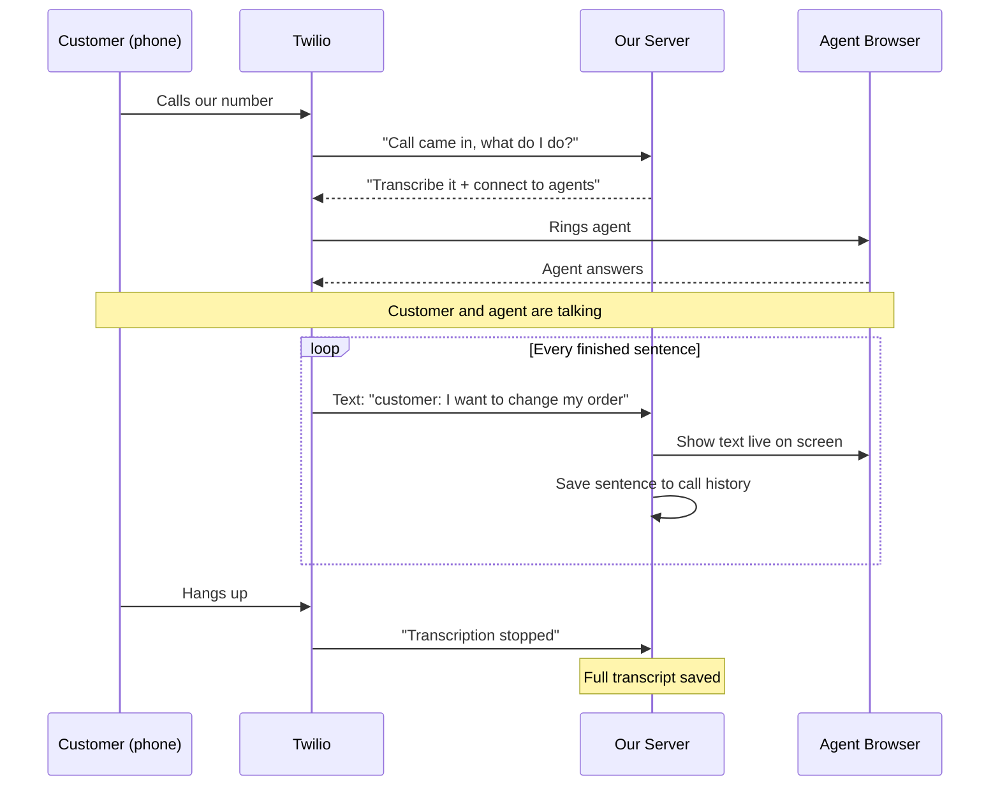

# Twilio research: live transcript and toll-free numbers

Status: Research
Date: 2026-10-19
Related: user-stories.md (US-30 transcript, US-51 transcription language), src/voice/

---

## 1. Live call transcript

### Sequence Diagram



### Options

| Option | How it works | Fits us? |
|---|---|---|
| **A. Twilio Real-Time Transcription** `<Start><Transcription>` | Twilio forks the call audio to Google or Deepgram STT and POSTs each utterance to our webhook | **Recommended.** No new infra, works with our TwiML-only setup |
| B. Media Streams + own STT `<Start><Stream>` | Twilio sends raw audio (8 kHz μ-law, base64) over a WebSocket to our server, and we pipe it to Deepgram, AssemblyAI or another STT | More control and possibly cheaper at volume, but we would run a WebSocket server and an STT client |
| C. Recording transcription | Transcribed after the call ends | Not live. Fine for US-30's "summary after the call" |

### Option A in detail

**TwiML.** Put `<Start>` before the `<Dial>`. `<Start>` is non-blocking, so the dial proceeds immediately:

```xml
<Response>
  <Start>
    <Transcription
      name="live"
      statusCallbackUrl="https://<public-host>/webhooks/twilio/transcription"
      track="both_tracks"
      inboundTrackLabel="customer"
      outboundTrackLabel="agent"
      partialResults="true"
      languageCode="en-US" />
  </Start>
  <Dial answerOnBridge="true">...</Dial>
</Response>
```

**Attributes we care about**

- `track`: `inbound_track`, `outbound_track`, or `both_tracks` (the default). `both_tracks` uses 2 of the 4 forks a call is allowed.
- `inboundTrackLabel` / `outboundTrackLabel`: speaker labels that come back on each event.
- `partialResults`: interim text while the speaker is still talking, for a "typing" effect. It sends many more webhooks.
- `transcriptionEngine`: `google`, `deepgram`, or `auto` (the default on new accounts). `speechModel` defaults to `telephony`.
- `languageCode`: BCP-47, default `en-US`. `multi` turns on Deepgram language detection. This maps to US-51's "transcription language" setting.
- `hints`: up to 500 words or phrases, such as product names and the business name.
- `profanityFilter` and `enableAutomaticPunctuation` both default to true.
- `intelligenceService`: also persists the transcript in Twilio Conversational Intelligence. This is optional and could feed the post-call summary in US-30.

**Webhook events (POST, form-encoded, signed like our other webhooks)**

| `TranscriptionEvent` | Key params |
|---|---|
| `transcription-started` | `CallSid`, `TranscriptionSid`, engine, track, labels |
| `transcription-content` | `CallSid`, `Track`, `TranscriptionData` (a JSON string: `{"transcript":"...","confidence":0.97}`), `Final` (true/false), `Stability` (partials only), `SequenceId`, `Timestamp` |
| `transcription-stopped` | Sent when the call ends or the session is stopped |
| `transcription-error` | Error code 32650–32655 plus a description |

`SequenceId` is ordered per track, not across tracks. Sort by `Timestamp` when interleaving the two speakers.

**Start or stop mid-call via REST.** This would let an agent press a "Transcribe" button:

```
POST /2010-04-01/Accounts/{AC}/Calls/{CA}/Transcriptions.json         (Name, Track, StatusCallbackUrl, ...)
POST /2010-04-01/Accounts/{AC}/Calls/{CA}/Transcriptions/{GT|Name}.json   Status=stopped
```

Or in TwiML: `<Stop><Transcription name="live"/></Stop>`.

**Cost.** List price is about $0.027/min for real-time transcription in the US, on top of call minutes. Check the current price on the voice pricing page.

**Compliance.** Both engines are HIPAA eligible. Recording and transcription consent rules still apply, so we may need a `<Say>` notice on inbound calls.

### Gotchas for our code

1. **"Inbound" and "outbound" are relative to the call leg that runs the TwiML, not to the call direction.**
   - Inbound PSTN call (`dialClients`): the parent leg is the customer, so `inbound_track` is the **customer** and `outbound_track` is the agent.
   - Browser-originated call (`dialNumber`, `From=client:...`): the parent leg is the **agent's browser**, so `inbound_track` is the **agent**.
   - So the labels have to be swapped per branch in `src/voice/routes.ts`.
2. **The transcript arrives at our server, not the browser.** Nothing in the app pushes to the browser in real time yet. We need a channel such as Server-Sent Events (simplest with Bun: one `text/event-stream` response per open `/voice` page) keyed by the agent's identity and `CallSid`. The browser already knows its `CallSid` from the Voice SDK `Call` object (`call.parameters.CallSid`). On a browser-originated call, that is the parent leg's SID, which matches what the webhook sends.
3. **Fork budget is 4 per call**, shared with Media Streams, SIPREC and AMD. `both_tracks` transcription uses 2, which leaves room for 1 `both_tracks` stream later.
4. **Signature check.** The new webhook should use `twilioParams()` like `/webhooks/twilio/status`.
5. **Storing the transcript.** Save only the `Final=true` events (call_sid, track/speaker, text, confidence, timestamp) for the call history. Partials should go to the live UI only.

### Suggested implementation steps

1. Add a `transcription()` helper in `src/voice/twilio.ts` that returns the `<Start><Transcription .../></Start>` string, and prepend it in `dialNumber` / `dialClients`, with the labels swapped per gotcha 1.
2. Add a `POST /webhooks/twilio/transcription` route that validates the signature, parses `TranscriptionData`, and stores the event if final.
3. Add `GET /api/voice/transcript/stream` as an SSE stream for the logged-in agent, and fan events out to that agent's open streams.
4. In `voice.html`, show a transcript panel bound to the active call.
5. Add a setting to turn it on or off, plus a language setting, to cover US-51.

---

## 2. Toll-free numbers

### What they are on Twilio

- US and Canada toll-free numbers use the prefixes 800, 833, 844, 855, 866, 877 and 888. They support voice plus SMS and MMS.
- The caller pays nothing; we pay for inbound minutes.
- **US pricing (list):** $2.15/month per number, $0.022/min inbound (local numbers: $1.15/month, $0.0085/min), and $0.014/min outbound to US/CA.
- International toll-free numbers exist for many countries, but availability, capabilities (often voice only) and paperwork vary by country. Check Twilio's international availability and toll-free restrictions pages per country.

### Prerequisites

1. **A paid account.** Trial accounts can't complete toll-free verification.
2. **A Trust Hub Primary (or Secondary) Customer Profile** before buying a toll-free number. As an ISV with **one subaccount per business** (see user-stories.md), each business needs its own Secondary Customer Profile under its subaccount. This becomes part of tenant onboarding.
3. **Outside US/CA:** an approved **Regulatory Bundle** that matches the country and number type (toll-free). The bundle's country, type and end user can't be changed after creation.

### Buying (Console)

1. Go to Communications > Numbers & senders > Phone Numbers > **Set up a new phone number**.
2. On Basic information, choose **Business / Nonprofit / Sole Proprietor**. Toll-free numbers only appear with this option.
3. Search with the type filter set to Toll-free, then Select > Purchase.
4. Set the number's **Voice "A call comes in"** webhook to `https://<public-host>/webhooks/twilio/voice`, the same webhook as our current number. No code change is needed. Toll-free numbers go through the same `dialClients` path, and the agent can use one as the `callerId` for outbound calls.

### Buying (API), for automated tenant onboarding

```
GET  /2010-04-01/Accounts/{AC}/AvailablePhoneNumbers/US/TollFree.json?AreaCode=844   (optional filters: Contains, VoiceEnabled, SmsEnabled)
POST /2010-04-01/Accounts/{AC}/IncomingPhoneNumbers.json    PhoneNumber=+1844...&VoiceUrl=https://.../webhooks/twilio/voice&StatusCallback=...
```

Use the tenant's subaccount SID and credentials so the number belongs to that subaccount.

### Toll-free verification (TFV)

- **Only needed for SMS/MMS to US and Canada.** An unverified toll-free number can't send SMS. TFV is a messaging compliance step; Twilio's TFV docs only describe its effect on messaging, so voice should not need it. Confirm with a test call on a freshly bought number before relying on this.
- Submit in Console (select the number > *Finish setting up your number*) or through the **Messaging Compliance API** (`/v1/Tollfree/Verifications`), which suits automated onboarding.
- **Information you submit:** business name, address, website, contact details, the business registration number (EIN for US), the use case and description, sample messages, how users opt in (with proof), expected monthly volume, and **separate privacy policy and terms URLs**. The last two are required since 2026-09-15, and submissions without them are rejected with error 30493.
- **Statuses:** Not verified, then In progress, then Approved or Rejected. A resubmittable rejection gets priority review if resubmitted within 7 days.
- **Review time:** typically days to a few weeks. Plan for weeks, not hours.
- Political (527) organizations also need a Campaign Verify token.

### Recommendation

- Add "Buy a toll-free number" as a number type in the "getting a number" stories, next to local numbers.
- Voice works through our existing webhook with no code change.
- Tenant onboarding has to create the Secondary Customer Profile first.
- If the business also wants SMS on the number, start TFV right after purchase and show its status in settings.

---

## Sources

- TwiML `<Transcription>`: https://www.twilio.com/docs/voice/twiml/transcription
- Real-time Transcription REST resource: https://www.twilio.com/docs/voice/api/realtime-transcription-resource
- Media Streams: https://www.twilio.com/docs/voice/media-streams
- Transcription pricing: https://support.twilio.com/hc/en-us/articles/43223127086235 and https://twilio.com/en-us/changelog/realtime-transcriptions-is-public-beta
- Voice pricing (US): https://www.twilio.com/en-us/voice/pricing/us
- TFV console onboarding: https://www.twilio.com/docs/messaging/compliance/toll-free/console-onboarding
- TFV API onboarding: https://twilio.com/docs/messaging/compliance/toll-free/api-onboarding
- TFV onboarding guide: https://support.twilio.com/hc/en-us/articles/13264118705051-Toll-Free-Verification-Onboarding-Guide
- Regulatory bundles and number availability: https://support.twilio.com/hc/en-us/articles/223183068
